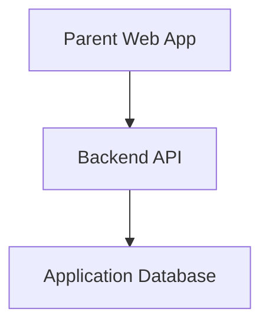
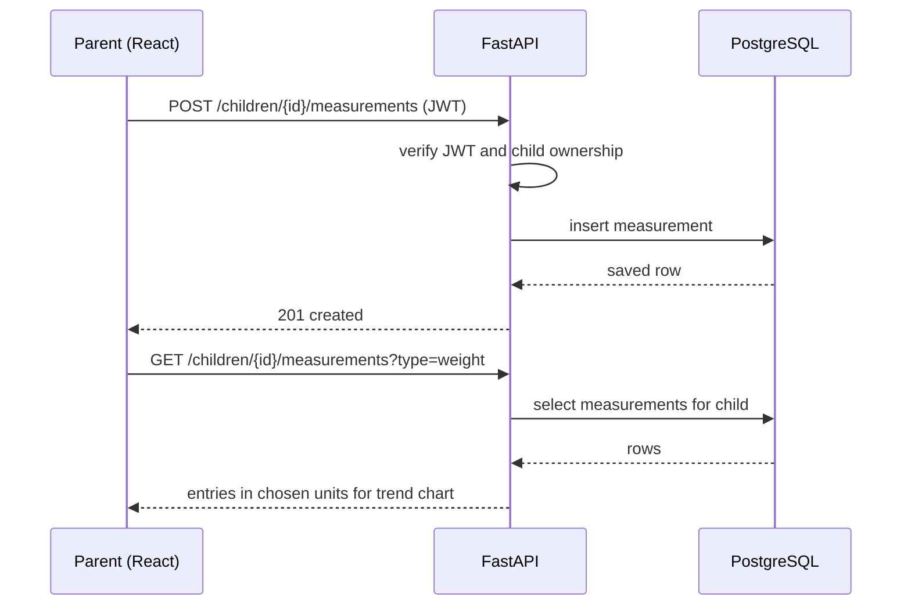
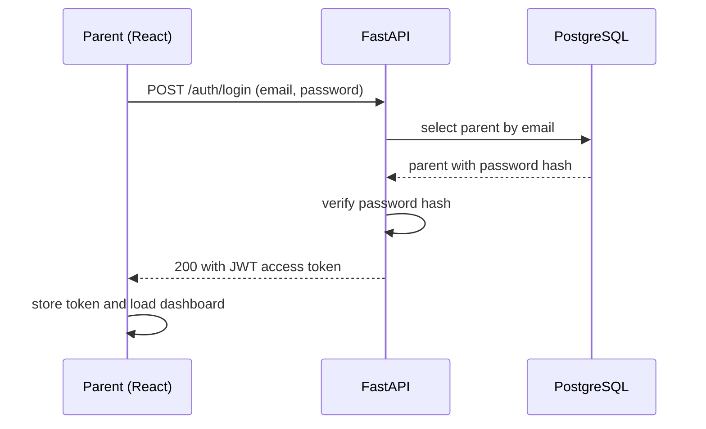
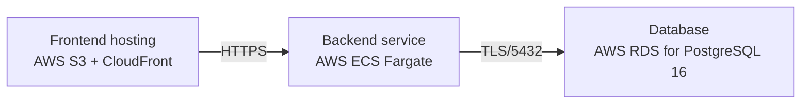

# Architecture

> Maintained by QuorQ AI SDLC. Text between `sdlc:auto` markers is regenerated; anything outside them is yours and is kept.

<!-- sdlc:auto:start narrative -->
## Overview

### ARCH-001 · approved · source: architecture:summary

_2026-11-06_

wedgw is approved as a lightweight responsive web app for parents to privately track children's weight and height over time.

Architecture v1, status approved. Parents sign in to a password-protected account, create one or more child profiles (name, date of birth, optional sex), record manual weight/height measurements by date, edit/delete them, and view weight-over-time and height-over-time trend charts. Units toggle between metric (kg/cm) and imperial (lb/in). Stack: React 19 SPA frontend, FastAPI 0.115 backend with JWT auth, PostgreSQL 16 database, deployed on AWS. All data is scoped to the owning account and follows the account across devices.

- ⚠ No requirements-phase input was provided for this project, so this architecture's references to NFR-001 through NFR-005 cannot be traced back to an approved requirements document.

### ARCH-COMP-web_app · approved · source: architecture:components:web_app

_2026-11-06_

Parent Web App is the React 19 responsive SPA covering sign-in, the children dashboard, profile and measurement management, unit selection, and trend charts.

Component: Parent Web App (web_app). Technology: React 19. Responsibilities: responsive SPA for sign-in, children dashboard, profile and measurement management, unit selection and trend charts.

**Related:** ARCH-TECH-frontend

### ARCH-COMP-api · approved · source: architecture:components:api

_2026-11-06_

Backend API is the FastAPI 0.115 service handling authentication, CRUD, unit conversion, and chart data, with per-account isolation enforced.

Component: Backend API (api). Technology: FastAPI 0.115. Responsibilities: authentication, authorization, CRUD for children and measurements, unit conversion and serving chart data. Enforces per-account data isolation on every request.

**Related:** ARCH-TECH-backend, ARCH-ENDPOINTS

### ARCH-COMP-db · approved · source: architecture:components:db

_2026-11-06_

Application Database is the PostgreSQL 16 store for parent accounts, child profiles, measurements, and preferences.

Component: Application Database (db). Technology: PostgreSQL 16. Responsibilities: persists parent accounts, child profiles, measurements and preferences.

**Related:** ARCH-TECH-database, ARCH-ENTITY

### ARCH-CRITPATH-record-view · approved · source: architecture:critical_paths

_2026-11-06_

Primary critical path: a signed-in parent records a measurement and then views the resulting trend chart.

A signed-in parent adds a weight or height entry for a child, then views the trend chart built from that child's entries in the selected unit system (metric or imperial).

**Related:** ARCH-COMP-web_app, ARCH-COMP-api, ARCH-ENDPOINTS

### ARCH-CRITPATH-signin · approved · source: architecture:critical_paths

_2026-11-06_

Second critical path: parent authentication via email/password producing a JWT used for all subsequent requests.

A parent authenticates with email and password and receives a JWT; this token is used to authorize all subsequent API requests.

**Related:** ARCH-COMP-api, ARCH-ENDPOINTS

### ARCH-ENTITY · approved · source: architecture:entities

_2026-11-06_

Three core entities: parents, children, measurements, modeling a one-to-many-to-many ownership chain for per-account isolation.

parents: id, email, password_hash, preferred_unit_system, created_at.
children: id, parent_id, name, date_of_birth, sex, created_at.
measurements: id, child_id, type, value_metric, taken_on, created_at.
Measurement values are stored in metric (value_metric) regardless of the parent's display preference, implying unit conversion happens at the API/presentation layer.

**Related:** ARCH-COMP-db

- ⚠ Entity list does not include a units/preferences table separate from parents.preferred_unit_system -- confirm this single field is sufficient for the PATCH /me/preferences endpoint's needs.

### ARCH-ENDPOINTS · approved · source: architecture:endpoints

_2026-11-06_

14 REST endpoints cover auth, preferences, child profile CRUD, and measurement CRUD, all scoped to the signed-in parent's account.

Auth: POST /auth/register (create account), POST /auth/login (sign in, receive JWT), POST /auth/logout (client discards token).
Account: GET /me (current parent + preferred unit system), PATCH /me/preferences (update preferred unit system).
Children: GET /children (list for dashboard), POST /children (create profile), GET /children/{child_id} (get one profile), PATCH /children/{child_id} (edit profile), DELETE /children/{child_id} (delete profile and its measurements).
Measurements: GET /children/{child_id}/measurements (list, optionally filtered by type, in chosen units, for history/charts), POST /children/{child_id}/measurements (record weight or height), PATCH /children/{child_id}/measurements/{id} (edit value or date), DELETE /children/{child_id}/measurements/{id} (delete entry).

**Related:** ARCH-COMP-api, ARCH-ENTITY, ARCH-CRITPATH-record-view, ARCH-CRITPATH-signin

### ARCH-DEPLOY · approved · source: architecture:deployment_nodes

_2026-11-06_

Deployment topology on AWS: static frontend via S3+CloudFront, backend API on ECS Fargate, database on RDS PostgreSQL 16.

Frontend hosting: AWS S3 + CloudFront serving the React 19 static build.
Backend service: AWS ECS Fargate running FastAPI 0.115 on Python 3.12 via Uvicorn.
Database: AWS RDS for PostgreSQL 16.

**Related:** ARCH-TECH-cloud, ARCH-COMP-web_app, ARCH-COMP-api, ARCH-COMP-db

### ARCH-TECH-frontend · approved · source: architecture:technology_decisions:frontend

_2026-11-06_

React 19 chosen for the frontend over Vue and Svelte, approved stack.

Decision: React 19 (alternatives considered: Vue, Svelte). Rationale: built as a responsive SPA so parents get the same UI on phone and desktop browsers (NFR-004) with a simple, non-technical layout (NFR-005).

**Related:** NFR-004, NFR-005

- ⚠ NFR-004 and NFR-005 are referenced but no requirements-phase input exists yet to confirm their exact wording or approval.

### ARCH-TECH-backend · approved · source: architecture:technology_decisions:backend

_2026-11-06_

FastAPI 0.115 chosen for the backend over Django REST Framework and Flask, approved stack.

Decision: FastAPI 0.115 (alternatives considered: Django REST Framework, Flask). Rationale: hosts JWT auth, CRUD and unit conversion, enforcing per-account isolation on every request (NFR-002).

**Related:** NFR-002

- ⚠ NFR-002 is referenced but no requirements-phase input exists yet to confirm its exact wording or approval.

### ARCH-TECH-database · approved · source: architecture:technology_decisions:database

_2026-11-06_

PostgreSQL 16 chosen for the database over MySQL and SQLite, approved stack.

Decision: PostgreSQL 16 (alternatives considered: MySQL, SQLite). Rationale: relational model fits parents -> children -> measurements cleanly with cascade deletes and strong consistency across devices (NFR-003).

**Related:** NFR-003

- ⚠ NFR-003 is referenced but no requirements-phase input exists yet to confirm its exact wording or approval.

### ARCH-TECH-cloud · approved · source: architecture:technology_decisions:cloud

_2026-11-06_

AWS chosen as the cloud provider over GCP and Azure, approved stack.

Decision: AWS (alternatives considered: GCP, Azure). Rationale: S3/CloudFront for the SPA, Fargate for the API, and RDS PostgreSQL with encryption at rest and TLS in transit (NFR-001).

**Related:** NFR-001

- ⚠ NFR-001 is referenced but no requirements-phase input exists yet to confirm its exact wording or approval.
<!-- sdlc:auto:end narrative -->

<!-- sdlc:auto:start building-blocks -->
## Building Block View

| ID | Name | Technology | Responsibility | Depends on |
|---|---|---|---|---|
| web_app | Parent Web App | React 19 | Responsive SPA for sign-in, children dashboard, profile and measurement management, unit selection and trend charts. | api |
| api | Backend API | FastAPI 0.115 | Authentication, authorization, CRUD for children and measurements, unit conversion and serving chart data. Enforces per-account data isolation. | db |
| db | Application Database | PostgreSQL 16 | Persists parent accounts, child profiles, measurements and preferences. | — |

<!-- sdlc:auto:end building-blocks -->

<!-- sdlc:auto:start runtime -->
## Runtime View

### Record and view a measurement

A signed-in parent adds a weight or height entry for a child, then views the trend chart built from that child's entries in the selected units.

- **Components:** web_app, api, db
- **Modules:** measurements_router, measurements_service, units, auth_deps
- **Key functions:** create_measurement(child_id, type, value, unit, taken_on), list_measurements(child_id), convert_value(value, from_unit, to_unit), require_current_parent(token)

### Parent sign-in

A parent authenticates with email and password and receives a JWT used for all subsequent requests.

- **Components:** web_app, api, db
- **Modules:** auth_router, auth_service, security
- **Key functions:** sign_in(email, password), verify_password(plain, hash), create_access_token(parent_id)

<!-- sdlc:auto:end runtime -->

<!-- sdlc:auto:start deployment-view -->
## Deployment View

| Name | Service | Runtime | Scaling | Environment |
|---|---|---|---|---|
| Frontend hosting | AWS S3 + CloudFront | React 19 static build | CDN edge, auto | dev |
| Backend service | AWS ECS Fargate | FastAPI 0.115 on Python 3.12 (Uvicorn) | 1 task for dev, horizontally scalable | dev |
| Database | AWS RDS for PostgreSQL 16 | PostgreSQL 16 | single instance for dev | dev |

| Source | Target | Protocol |
|---|---|---|
| Frontend hosting | Backend service | HTTPS |
| Backend service | Database | TLS/5432 |

<!-- sdlc:auto:end deployment-view -->

<!-- sdlc:auto:start decisions -->
## Architecture Decisions

| Layer | Choice | ADR |
|---|---|---|
| Frontend | React 19 | [ADR-0001](adr/frontend.md) |
| Backend | FastAPI 0.115 | [ADR-0002](adr/backend.md) |
| Database | PostgreSQL 16 | [ADR-0003](adr/database.md) |
| Cloud | AWS | [ADR-0004](adr/cloud.md) |
<!-- sdlc:auto:end decisions -->

<!-- sdlc:auto:start links -->
## Related Documents

- [Data Model](data-model.md)
- [API Specification](api/openapi.yaml)
- [Architecture Decision Records](adr/README.md)
<!-- sdlc:auto:end links -->
