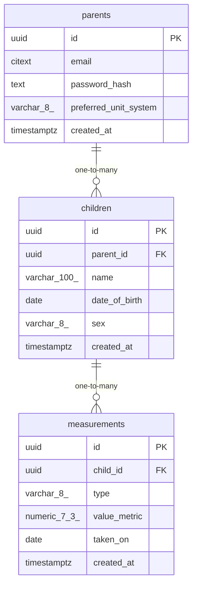

# Data Model

<!-- sdlc:auto:start entities -->
### parents

| Field | Type | PK | FK | Nullable |
|---|---|---|---|---|
| id | uuid | True | — | False |
| email | citext | False | — | False |
| password_hash | text | False | — | False |
| preferred_unit_system | varchar(8) | False | — | False |
| created_at | timestamptz | False | — | False |

### children

| Field | Type | PK | FK | Nullable |
|---|---|---|---|---|
| id | uuid | True | — | False |
| parent_id | uuid | False | parents.id | False |
| name | varchar(100) | False | — | False |
| date_of_birth | date | False | — | False |
| sex | varchar(8) | False | — | True |
| created_at | timestamptz | False | — | False |

### measurements

| Field | Type | PK | FK | Nullable |
|---|---|---|---|---|
| id | uuid | True | — | False |
| child_id | uuid | False | children.id | False |
| type | varchar(8) | False | — | False |
| value_metric | numeric(7,3) | False | — | False |
| taken_on | date | False | — | False |
| created_at | timestamptz | False | — | False |
<!-- sdlc:auto:end entities -->

<!-- sdlc:auto:start relationships -->
| Source | Target | Type |
|---|---|---|
| parents | children | one-to-many |
| children | measurements | one-to-many |
<!-- sdlc:auto:end relationships -->

<!-- sdlc:auto:start er-diagram -->

<!-- sdlc:auto:end er-diagram -->
